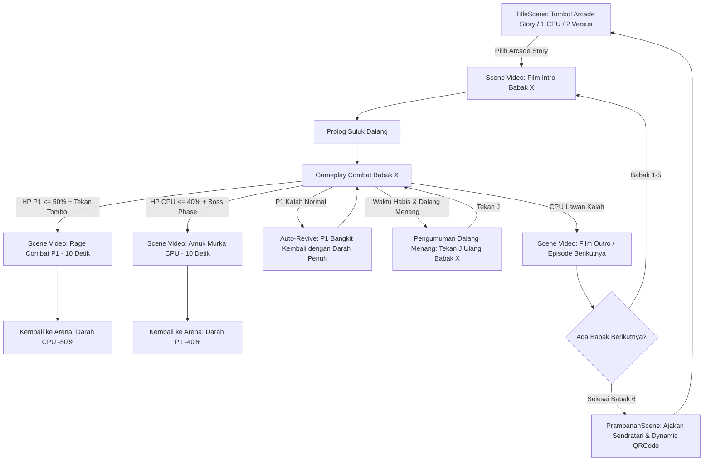

# SPEC: Ramayana Arcade Story Mode (Lakon 6 Babak Lengkap)

## 1. Ringkasan Eksekutif (Executive Summary)
Mengembangkan game fighting *Hanoman Wayang* menjadi **Arcade Story Mode Epik Ramayana** yang menggabungkan pertarungan wayang kulit dengan elemen *Cinematic Interactive Movie* dalam 6 babak wiracarita lengkap.

Mode ini dapat diakses langsung dari tombol **[Arcade / Cerita Ramayana]** di menu depan (`TitleScene`). Setiap babak menyajikan alur sinematik terpadu: **Film Intro $\rightarrow$ Combat Babak $\rightarrow$ Film Episode Berikutnya**, dilengkapi mekanik pamungkas **Rage Combat Cutscene (Amuk Wayang)** untuk Player 1 dan CPU Dalang, sistem **Auto-Revive**, serta epilog budaya panggung terbuka **Sendratari Ramayana Prambanan** dengan QR Code reservasi tiket dinamis.

---

## 2. Arsitektur Alur Permainan & Scene Management



---

## 3. Spesifikasi Mekanik Khusus Cerita

### 3.1 Tombol Arcade di Menu Utama (`TitleScene`)
- Menu utama menyediakan 3 opsi jelas:
  1. **[1 / ENTER / KLIK] ⚔️ ARCADE STORY : RAMAYANA ⚔️**
  2. **[1] Lawan Dalang (CPU Single Match)**
  3. **[2] Dua Pemain (Versus Local)**
- Dilengkapi animasi *scale pulse*, efek *hover*, dan navigasi keyboard (`ENTER` / `SPACE`).

### 3.2 Mekanik Sinematik Rage Combat (Amuk Wayang)
- **Rage Combat Player 1 (Amuk Sakti):**
  - **Kondisi Aktif:** Darah karakter sebelah kiri (Player 1) mencapai $\le 50\%$.
  - **Trigger:** Pemain menekan tombol aksi apapun.
  - **Efek:** Memotong darah lawan sebelah kanan (CPU) sebesar **50%**.
  - Kuota: 1 kali per babak.
- **Rage Combat CPU / Dalang (Amuk Murka):**
  - **Kondisi Aktif:** Darah CPU mencapai $\le 40\%$ (*Boss Phase Threshold*).
  - **Visual Telegraphing:** Peringatan visual berkedip merah dan getaran layar (*screen shake*) selama 1.25 detik sebelum video terpicu.
  - **Efek:** Memotong darah Player 1 sebesar **40%**.
  - Kuota: 1 kali per babak.

### 3.3 Sistem Auto-Revive & Rematch Preserving
- **Auto-Revive P1:**
  - Jika darah Player 1 habis oleh serangan normal CPU, P1 tidak langsung K.O.
  - Terjadi efek suara kebangkitan; darah pulih ke 100%, disertai gelombang tolak (*pushback*) dan pemulihan posisi getup.
- **Rematch Preserving State (Tombol `J`):**
  - Jika Dalang memenangkan ronde waktu habis (*Time Out*), layar mengumumkan kemenangan Dalang.
  - Menekan tombol `J` mengulang pertandingan pada babak yang sama (`chapterIndex`, karakter P1, dan CPU tetap terjaga), tanpa me-reset kembali ke Babak 1.

### 3.4 Layar Budaya Sendratari Ramayana Prambanan (`PrambananScene.ts`)
- **Pemicu:** Ditampilkan otomatis setelah video outro Babak 6 (`outro_episode_6.mp4`) selesai diputar.
- **Komponen Visual:**
  - Latar gelap teatrikal (`0x0c0704`) dengan bingkai ornamen emas bertingkat dan aksen sudut ukiran Jawa.
  - Badge pill: `🏛️ SENDRATARI RAMAYANA PRAMBANAN`.
  - Headline utama: *"Kamu Sudah Memainkannya. Sekarang, Duduklah dan Saksikan Mereka Menari."*
  - Narasi puitis anti-AI slop yang mengajak pemain menyaksikan pertunjukan panggung terbuka Ramayana sejak 1961 di Candi Prambanan.
  - Dynamic QR Code berbasis library `qrcode` yang dirender ke CanvasTexture mengarah ke `https://injourneydestination.id/`.
  - Tombol interaktif klik langsung `🌐 Buka injourneydestination.id ↗` untuk reservasi tiket di browser.
  - Tombol shortcut `[ SPASI / ENTER / ESC / KLIK ]` untuk kembali ke Menu Utama.

---

## 4. Sistem Manajemen Narasi Cerita (`scripts/story-manager.py`)

Tool CLI interaktif untuk admin/dalang mengelola alur cerita:
```bash
npm run story:admin
# atau: python scripts/story-manager.py
```

### 4.1 Fitur Story Manager:
1. Menentukan total scene combat.
2. Memilih karakter P1 dan CPU dari daftar karakter siap tayang di `src/assets/characters/`.
3. Memilih file video intro, outro, variasi video amuk P1, dan video amuk CPU.
4. Mengatur parameter promosi Sendratari Prambanan (URL QRCode, badge, headline, CTA).
5. Menyimpan konfigurasi ke `src/data/story-config.json`.

---

## 5. Kontrak Data Konfigurasi Cerita (`story-config.json`)

```json
{
  "totalChapters": 6,
  "chapters": [
    {
      "chapterIndex": 1,
      "title": "Aliansi Kiskenda",
      "subtitle": "Sugriwa vs Subali",
      "player1": "sugriwa",
      "cpu": "subali",
      "introVideo": "/videos/intro_babak_1.mp4",
      "outroVideo": "/videos/outro_babak_1.mp4",
      "playerRageVideos": [
        "/videos/combo_1_sugriwa_ke_subali.mp4",
        "/videos/combo_2_sugriwa_ke_subali.mp4"
      ],
      "cpuRageEnabled": true,
      "cpuRageVideos": [
        "/videos/combo1_subali.mp4"
      ]
    }
  ],
  "prambananPromo": {
    "enabled": true,
    "badge": "SENDRATARI RAMAYANA PRAMBANAN",
    "headline": "Kamu Sudah Memainkannya.\nSekarang, Duduklah dan Saksikan Mereka Menari.",
    "bodyText": "Menggerakkan Hanoman melompati kelir layar hanyalah permulaan...\n\nHadir dan jadilah saksi langsung epik terbesar tanah Jawa di panggung terbuka termegah nusantara.",
    "ctaText": "Pindai untuk reservasi kursi pertunjukan via injourneydestination.id",
    "qrUrl": "https://injourneydestination.id/"
  }
}
```

---

## 6. Pengujian Otomatis (Automated Unit Testing)

Suite pengujian otomatis dikembangkan di `tests/arcade-flow.test.ts` dan dijalankan dengan:
```bash
npm test
```
Cakupan test suite:
1. **Rematch Babak 3**: Memastikan tombol `J` setelah Dalang menang tetap mempertahankan Babak 3 (Hanoman vs Indrajit) dan skor reset ke 0-0.
2. **Progresi Babak**: Memastikan kemenangan P1 di Babak 3 memutar outro babak 3 dan lanjut ke Babak 4 (Laksmana vs Yuyukangkang).
3. **Epilog Prambanan**: Memastikan kemenangan P1 di Babak 6 mengarah ke `PrambananScene`.
4. **Auto-Revive**: Memastikan P1 pulih 1000 HP saat darah menyentuh 0 di mode Arcade.

---

## 7. Status & Ringkasan Pengerjaan

| Komponen | Deskripsi | Status |
| :--- | :--- | :--- |
| **Assets & Rig 10 Karakter** | Hanoman, Sugriwa, Subali, Rahwana, Jatayu, Indrajit, Yuyu Kangkang, Laksmana, Kumbakarna, Rama | Selesai |
| **Alur 6 Babak Cerita** | 6 babak sinematik epos Ramayana lengkap | Selesai |
| **CPU Rage Combat** | Boss phase amuk Dalang pada HP $\le 40\%$ | Selesai |
| **Prambanan Promo Scene** | Epilog budaya, copywriting anti-AI slop, dynamic QR Code | Selesai |
| **Rematch Bugfix** | Preservasi babak saat tombol `J` ditekan | Selesai |
| **Automated Test Suite** | 4 unit test alur cerita lolos 100% | Selesai |
| **Dojo Rig Simulator Lab** | Pengujian kombat, AI dummy, visualizer hitbox (`H`), & slider sendi | Selesai |
