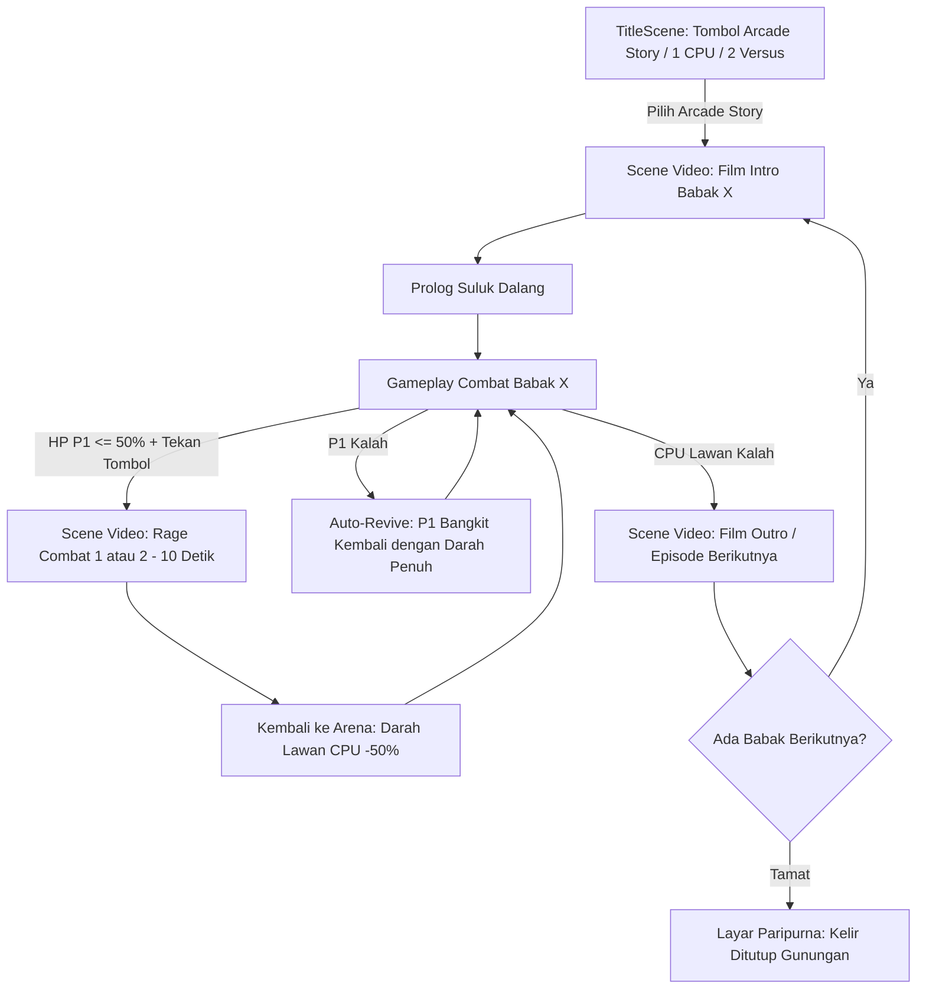

# SPEC: Ramayana Arcade Story Mode (Lakon 5 Babak)

## 1. Ringkasan Eksekutif (Executive Summary)
Mengembangkan game fighting *Hanoman Wayang* menjadi **Arcade Story Mode Epik Ramayana** yang menggabungkan pertarungan wayang kulit dengan elemen *Cinematic Interactive Movie*.

Mode ini dapat diakses langsung dari tombol **[Arcade / Cerita Ramayana]** di menu depan (`TitleScene`). Setiap babak menyajikan alur sinematik terpadu: **Film Intro $\rightarrow$ Combat Babak $\rightarrow$ Film Episode Berikutnya**, dilengkapi mekanik pamungkas **Rage Combat Cutscene** dan sistem **Auto-Revive** agar pemain selalu dapat menyelesaikan kisah epos Ramayana hingga tuntas.

---

## 2. Arsitektur Alur Permainan & Scene Management



---

## 3. Spesifikasi Mekanik Khusus Cerita

### 3.1 Tombol Arcade di Menu Utama (`TitleScene`)
- Menu utama menyediakan 3 opsi jelas:
  1. **[1 / ENTER / KLIK] ⚔️ ARCADE STORY : RAMAYANA ⚔️**
  2. **[1] Lawan Dalang (CPU Single Match)**
  3. **[2] Dua Pemain (Versus Local)**
- Dilengkapi animasi *scale pulse*, efek *hover*, dan navigasi keyboard (`ENTER` / `SPACE`).

### 3.2 Mekanik Sinematik Rage Combat (Amuk Wayang)
- **Kondisi Aktif:** Darah karakter sebelah kiri (Player 1) mencapai $\le 50\%$.
- **Trigger:** Pemain menekan tombol aksi apapun.
- **Tampilan Cutscene:** Game mem-pause arena pertarungan, memutar cutscene video berdurasi $\pm 10$ detik secara acak antara:
  - `rage_combat_1.mp4` / `WebM`
  - `rage_combat_2.mp4` / `WebM`
  *(Catatan: Disediakan fallback animasi kanvas jika file video belum diunggah).*
- **Efek Pasca-Video:**
  - Game kembali ke arena dengan posisi netral dan jeda aman 0.5 detik.
  - Darah musuh di sebelah kanan (CPU) langsung berkurang **50%**.
  - Flag amuk terkunci (hanya dapat digunakan 1 kali per ronde/babak untuk mencegah spam).

### 3.3 Sistem Auto-Revive (Karakter P1 Hidup Kembali)
- Mengingat cerita Ramayana harus berjalan sesuai takdir kemenangan kebajikan atas angkara murka, jika Player 1 dikalahkan oleh CPU:
  - Karakter Player 1 tidak terkena Game Over.
  - Terjadi efek suara genta/suluk kebangkitan; karakter P1 bangkit kembali (*auto-revive*), darah pulih ke 100%, disertai gelombang tolak (*pushback*) dan kekebalan 2 detik agar tidak terkena serangan beruntun.

### 3.4 Management Scene Sinematik (Video Cutscenes)
- Format Scene terpisah (`CinematicScene`) yang menangani:
  - Pemutaran video layar penuh / aspect ratio terjaga.
  - Tombol **[Space / Klik] Skip** untuk kenyamanan replayability.
  - Transisi halus fade to black / gunungan kelir sebelum dan sesudah video.

---

## 4. Sistem Manajemen Narasi Cerita (Story Management Admin Tool)

Untuk memudahkan admin mengatur jumlah babak, karakter bertanding, dan video intro/outro, disediakan tool CLI interaktif:

### 4.1 Perintah Eksekusi
```bash
npm run story:admin
# atau: python scripts/story-manager.py
```

### 4.2 Alur Pertanyaan Interaktif Admin:
1. **Pertanyaan 1 (Jumlah Scene):**
   - Menanyakan berapa total scene combat yang ingin dijalankan (contoh: 2 babak atau 5 babak).
2. **Pertanyaan 2 (Karakter Combat per Babak):**
   - **Karakter Player 1 (Sebelah Kiri):** Menampilkan daftar nomor karakter yang siap tayang yang dipindai otomatis dari folder `src/assets/characters/`.
   - **Karakter CPU (Sebelah Kanan):** Menampilkan daftar nomor karakter siap tayang yang sama untuk dipilih oleh admin.
3. **Pertanyaan 3 (File Video Sinematik per Babak):**
   - **Film INTRO:** Memilih dari video yang ada di folder `public/videos/` atau mengetik nama file video kustom.
   - **Film OUTRO / Episode Berikutnya:** Memilih video outro babak.
   - **Film Rage Combat 1 & 2:** Mengonfirmasi file video amuk 10 detik.

### 4.3 Target Penyimpanan Data
Tool ini otomatis menulis dan memvalidasi file:
- **`src/data/story-config.json`**

---

## 5. Kontrak Data Konfigurasi Cerita (`story-config.json`)

```json
{
  "totalChapters": 2,
  "chapters": [
    {
      "chapterIndex": 1,
      "title": "Aliansi Kiskenda",
      "subtitle": "Hutan Gua Kiskenda",
      "player1": "sugriwa",
      "cpu": "subali",
      "introVideo": "/videos/intro_babak_1.mp4",
      "outroVideo": "/videos/outro_babak_1.mp4",
      "rageVideos": [
        "/videos/rage_combat_1.mp4",
        "/videos/rage_combat_2.mp4"
      ]
    },
    {
      "chapterIndex": 2,
      "title": "Penculikan Sinta",
      "subtitle": "Langit Hutan Dandaka",
      "player1": "jatayu",
      "cpu": "rahwana",
      "introVideo": "/videos/intro_babak_2.mp4",
      "outroVideo": "/videos/outro_babak_2.mp4",
      "rageVideos": [
        "/videos/rage_combat_1.mp4",
        "/videos/rage_combat_2.mp4"
      ]
    }
  ]
}
```

---

## 6. Mitigasi Risiko & Keamanan Teknis

1. **Autoplay Policy Browser:** Scene video dijalankan setelah pemain berinteraksi dengan tombol menu utama.
2. **Asset Missing Fallback:** Jika file video di `public/videos/` belum ada di disk, `CinematicScene` otomatis menampilkan kartu animasi wayang sinematik dinamis dengan teks narasi dramatis selama 5-10 detik agar game tidak macet atau crash.
3. **State Protection:** Saat cutscene diputar, logic loop `FightScene` di-pause (`scene.pause()`), semua input dinonaktifkan, dan timer hit-stop dibekukan.
4. **Encoding Aman Terminal Windows:** Script `story-manager.py` dikonfigurasi dengan UTF-8 fallback agar kompatibel di PowerShell Windows tanpa `UnicodeEncodeError`.

---

## 7. Fitur Dojo & Rig Simulator Lab

Untuk pengujian dan simulasi karakter hasil pemotongan dan penulangan rig (*rig building*), disediakan scene khusus **Dojo Uji Coba Rig** (`DojoScene.ts`) yang dapat diakses langsung dari menu utama:

### 7.1 Fitur Dojo:
1. **Interactive Movement & Combat Sandbox (Opsi 1):**
   - Mengendalikan karakter secara real-time dengan kendali pemain (gerak kiri/kanan, lompat, tangkis, pukul, tendang).
   - Memilih karakter target/boneka latih (Dummy AI) dengan berbagai mode perilaku:
     - `Idle`: Boneka diam di tempat.
     - `Guard`: Boneka selalu menangkis.
     - `Aggressive`: Boneka aktif menyerang untuk menguji responsifitas *hurtbox* dan *hitbox*.
   - **Tampilan Debug Hitbox & Skeleton (Tombol `H`):** Menampilkan garis kerangka sendi wayang (*joint pivots*) dan kotak deteksi pukulan/tendangan secara transparan.

2. **Live Joint Angle Tuning Sliders (Opsi 2):**
   - Panel slider DOM di pojok kanan atas untuk memutar sudut sendi secara presisi:
     - Kepala (*Head*)
     - Lengan Atas Depan & Belakang (*Upper Arms*)
     - Lengan Bawah Depan & Belakang (*Forearms*)
     - Kaki (*Legs*)
   - Memudahkan kalibrasi visual pivot tanpa perlu bolak-balik mengubah angka di file JSON.

3. **Instant Character Switcher:**
   - Tombol shortcut `C` atau tombol antarmuka untuk mengganti karakter uji (Hanoman, Sugriwa, Subali, Rahwana) secara instan di arena.

---

## 8. Catatan Perbaikan Rig Karakter (Rig Fixing Log)

### 8.1 Perbaikan Lengan Sugriwa (Double / 4 Arms Bug)
- **Gejala:** Karakter Sugriwa tampak memiliki 4 lengan saling menyilang saat berdiri dan menyerang.
- **Penyebab:** Pada file `sugriwa-parts.jpg`, lengan atas dan lengan bawah bersentuhan pada siku. Karena file `scripts/rigs/sugriwa.json` awalnya belum memiliki poligon pembatas (`keep` dan `drop`) di area siku, algoritma pemotong otomatis menyalin seluruh lengan utuh ke dalam `frontUpper.png` sekaligus `frontFore.png`. Ketika engine menempelkan lengan bawah ke siku lengan atas, lengan utuh menempel pada lengan utuh lainnya.
- **Resolusi:** Koordinat poligon pembatas siku ditambahkan ke `scripts/rigs/sugriwa.json`, dan script `build-rig.py` dijalankan ulang sehingga potongan lengan terpisah sempurna (~13-14 KB per ruas).

---

### 8.2 Penyelesaian Rig Jatayu (Garuda Wing Rigging)
- **Gejala:** Karakter Jatayu awalnya tidak muncul di daftar pilihan Dojo dan sempat gagal diekstraksi.
- **Penyebab:** Jatayu berpostur burung garuda bersayap (bukan kera/humanoid), sehingga koordinat seed template lama mengenai area putih di luar potongan gambar.
- **Resolusi:** Koordinat 11 potongan tubuh Jatayu (kepala, badan berzirah emas, sendi sayap, sayap utama kiri & kanan, cakar kaki depan & belakang, ekor merak kipas, dan selendang) berhasil dipetakan secara presisi pada `scripts/rigs/jatayu.json`. Skrip `build-rig.py` sukses menghasilkan `rig.json` dan 11 potongan wayang. Jatayu kini telah terdaftar di `Fighter.ts`, `DojoScene.ts`, serta Admin Story Manager.

---

## 9. Status & Ringkasan Pengerjaan (Implementation Status)

| Komponen | Deskripsi | Status |
| :--- | :--- | :--- |
| **Assets & Rig Karakter** | Hanoman, Sugriwa, Subali, Rahwana, Jatayu diekstraksi & dirakit | Selesai |
| **TitleScene UI Navigation** | Tombol navigasi Arcade Story, CPU, 2P, dan Dojo Rig | Selesai |
| **Story Management Tool** | Script CLI admin interaktif (`npm run story:admin`) | Selesai |
| **Data Contract (`story-config.json`)** | Skema konfigurasi babak cerita dan alur video | Selesai |
| **Dynamic Fighter Rig Loader** | Mendukung pemuatan karakter lawan/pemain dinamis | Selesai |
| **CinematicScene & Rage Combat** | Scene video, kartu sinematik dramatis fallback, dan mekanik rage amuk | Selesai |
| **Auto-Revive Mechanic** | Mekanisme bangkit kembali saat P1 kalah di story mode | Selesai |
| **Dojo Rig Simulator Lab** | Pengujian kombat, AI dummy, visualizer hitbox (`H`), & slider sendi | Selesai |
| **Sugriwa Rig Masking Fix** | Koreksi pemisah sendi siku sehingga lengan tidak dobel | Selesai |
