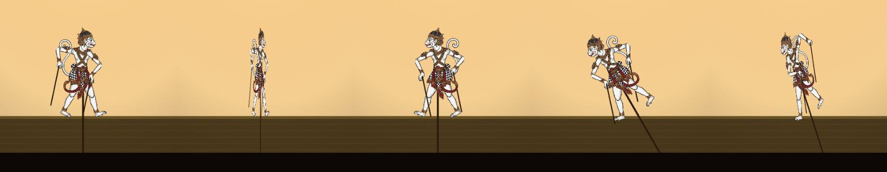
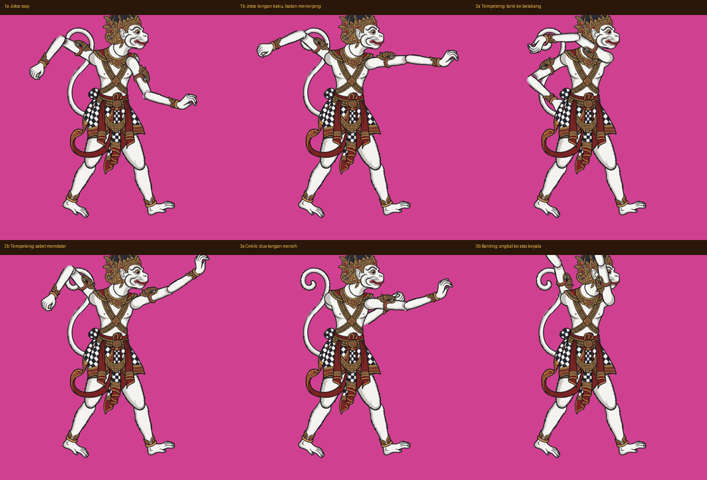

# Draft: gerakan bertarung ala wayang kulit

Status: **draft**, menunggu video referensi gerakan perang wayang dari pemilik.
Video disimpan di `assets-src/video/` (potongan 10–30 detik per adegan, atau sebutkan menit:detik).

## Prinsip

Wayang kulit punya batasan fisik, dan gerak khasnya justru lahir dari situ:

- **Kaki menyatu dengan badan, tidak bisa diayun.** Tendangan dilakukan dengan memutar atau mendorong seluruh boneka.
- **Lengan hanya berputar di bahu dan siku lewat tuding.** Tangan kaku, jari tidak bergerak.
- **Tenaga pukulan datang dari gapit:** lengan dibuat kaku, lalu seluruh badan yang menerjang. Atau dari ayunan tuding yang lebar dengan lecutan di ujung (sudah ada lewat pegas).
- **Ritme sentak lalu tahan,** mengikuti keprak.

## 1. Tendang berbalik (sudah dibuat, belum digabung ke `main`)

Branch `tendang-berbalik`, commit `0a47c03`.

Boneka diputar di sumbu tegak seperti koin: menyempit, membelakangi lawan, lalu menyodok dengan condong 30° sehingga kaki terdorong ke samping ke arah lawan, lalu berbalik lagi.

Catatan: ancang-ancang putaran 7 frame, jadi kena di frame 10 (sebelumnya 8).

## 2. Jurus tangan (rancangan, belum dibuat)

| Jurus | Menggantikan | Gerakan |
|---|---|---|
| **Jotos** (1a → 1b) | Tinju | Tangan depan diluruskan kaku ke depan, lengan belakang ditarik sebagai penyeimbang. Seluruh badan menerjang maju dan condong, lalu ditahan. |
| **Tempeleng** (2a → 2b) | Cakar | Tangan depan ditarik jauh ke belakang kepala, lalu disabetkan mendatar setinggi kepala lawan, dengan badan sedikit terpuntir. Ujungnya melecut karena pegas. |
| **Cekik → Banting** (3a → 3b) | jurus baru | Dari jarak dekat (J + K bersamaan), kedua tangan meraih leher lawan, mengangkatnya ke atas kepala, lalu membantingnya ke gedebog di belakang. Tidak bisa ditangkis. |
| **Gempur** | tetap | Dua tangan dari atas kepala dihantamkan ke bawah sambil meloncat. |

Rencana combo: J → J → J = Tempeleng → Jotos → Gempur; K → J = Tendang berbalik → Jotos; J + K dari dekat = Cekik → Banting.

### Catatan teknis
- Jotos dan Tempeleng hanya mengubah data jurus di `COMBO.moves` (`src/constants.ts`), jadi cepat dicoba.
- Saat Cekik, lengan belakang tertutup badan (lengan belakang terpasang di balik badan). Pilihannya: pindahkan kedua lengan ke lapisan depan selama jurus ini, atau cukup satu tangan yang mencekik.
- Banting butuh sistem baru: lawan ditempelkan ke tangan selama diangkat, lalu dilempar (tidak bisa ditangkis, ada jarak minimum).

## Yang dicari dari video referensi
- Pose kunci tiap serangan tangan dan kaki: ancang-ancang, puncak, dan tahan.
- Tempo: berapa lama ancang-ancang, sentakan, dan tahan.
- Cara dalang membuat boneka mengangkat dan membanting boneka lain.
- Reaksi boneka yang terkena pukulan.
